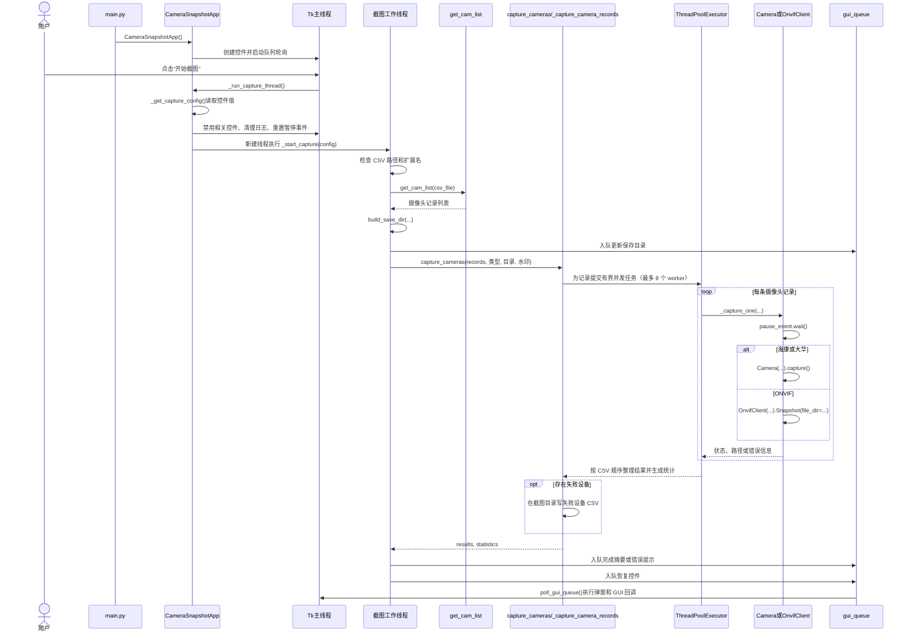

# 批量截图程序流程说明

本文按当前代码梳理程序从启动到截图结果回到界面的调用关系，重点说明 CSV 网络摄像头批量流程，并补充本地 USB 与单台临时截图分支。

## 1. 程序入口与 GUI 初始化

程序默认入口是 `main.py`：

1. 判断当前是否运行在 PyInstaller 环境，设置打包资源目录。
2. 调用 `setup_logging()` 初始化日志。
3. 导入 `capture_tk`。
4. 在 `__main__` 中创建 `CameraSnapshotApp()`，然后调用 `app.run()`。

日志在默认入口中只初始化一次；直接运行 `capture_tk.py` 时，会在其入口处初始化日志。

`CameraSnapshotApp.__init__()` 创建 Tk 根窗口、状态变量和界面控件，之后启动 GUI 队列轮询。`run()` 调用 `root.mainloop()` 进入事件循环。

主要位置：

- `main.py`：程序入口和应用实例创建。
- `capture_tk.py:CameraSnapshotApp.__init__()`：创建窗口、状态变量和 GUI 队列轮询。
- `capture_tk.py:CameraSnapshotApp._create_widgets()`：创建摄像头类型、CSV、目录、临时截图和操作控件。

## 2. CSV 网络摄像头批量截图

### 调用顺序



### 逐步说明

1. 用户点击“开始截图”后，Tk 主线程执行 `CameraSnapshotApp._run_capture_thread()`。
2. `_get_capture_config()` 从控件读取摄像头类型、水印开关、CSV 路径和保存目录。随后界面禁用关键按钮、清空日志并设置 `pause_event` 为运行状态。
3. `_run_capture_thread()` 创建后台线程，调用 `_start_capture(config)`。CSV 读取、目录创建和设备通信不在 Tk 主线程执行。
4. `_start_capture()` 对网络摄像头检查 CSV 路径和 `.csv` 扩展名，然后调用 `get_cam_list()` 一次性读取记录。解析器会处理 UTF-8 BOM、表头空格和大小写，检查重复表头及必填字段，并跳过字段缺失或列数过多的记录。
5. `build_save_dir()` 根据用户选择或 CSV 文件名创建输出目录，目录层级包含日期和时间。GUI 保存目录控件通过 `gui_queue` 更新。
6. 海康、大华、ONVIF 都调用 `capture_cameras()`，传入已经解析好的记录，避免采集层再次读取 CSV。
7. `_capture_camera_records()` 使用 `ThreadPoolExecutor` 并发采集，默认最多 8 个 worker。结果最终按 CSV 行顺序归集，而不是按设备完成顺序排列。
8. `_capture_one()` 在执行设备操作前等待 `pause_event`：
   - 海康/大华：创建 `Camera`，调用 `Camera.capture()`。
   - ONVIF：创建 `OnvifClient`，调用 `Snapshot()` 保存快照。此批量路径直接使用 ONVIF 快照接口，不经过 `Camera.camera_path`。
9. 每台设备的异常被记录为该设备失败，不会阻断其他摄像头。汇总包含总数、成功数、失败数、失败设备列表和系统错误。
10. 有失败设备时，在截图输出目录生成失败 CSV。完成后 `_start_capture()` 将摘要通过 `gui_queue` 发给 GUI，并在 `finally` 中恢复暂停事件和控件。

## 3. 单台 `Camera.capture()` 的内部流程

海康/大华批量任务会为每条 CSV 记录执行一次 `Camera.capture()`：

```mermaid
flowchart TD
    A[Camera.capture()] --> B{网络摄像头可用?}
    B -- 否 --> C[返回 -1: 离线或端口不可达]
    B -- 是或本地摄像头 --> D[生成完整截图路径]
    D --> E[读取 camera_path]
    E --> F[创建 cv2.VideoCapture]
    F --> G{本地 USB 摄像头?}
    G -- 是 --> H[设置分辨率并读取两帧预热]
    G -- 否 --> I{视频对象已打开?}
    H --> I
    I -- 否 --> J[抛出采集错误]
    I -- 是 --> K[读取正式帧]
    K --> L{帧有效?}
    L -- 否 --> J
    L -- 是 --> M{启用水印?}
    M -- 是 --> N[绘制文件名水印]
    M -- 否 --> O[JPEG编码]
    N --> O
    O --> P{编码成功?}
    P -- 否 --> Q[返回 -2: 编码失败]
    P -- 是 --> R[写入图片并检查文件非空]
    R --> S{保存成功?}
    S -- 否 --> T[返回 -2: 保存失败]
    S -- 是 --> U[返回 1 和图片路径]
    J --> V[返回 -3 和异常信息]
    C --> W[finally释放资源并清空帧]
    Q --> W
    T --> W
    U --> W
    V --> W
```

状态码约定：

| 状态码 | 含义 | 结果字段 |
|---|---|---|
| `1` | 截图成功 | 图片路径 |
| `-1` | 网络摄像头不可达 | 错误信息 |
| `-2` | JPEG 编码或文件保存失败 | 错误信息 |
| `-3` | 采集过程中发生异常 | 异常信息 |

`Camera.capture()` 在 `finally` 中释放视频对象并清空帧数据。当前本地 USB 批量入口是 `batch_capture_computer_cameras()`，依次尝试索引 `0` 到 `max_index - 1`，默认最多尝试 3 个索引。

## 4. 暂停与 GUI 线程

- 暂停按钮调用 `CameraSnapshotApp._toggle_pause()`。
- 暂停时清除 `utils.log_utils.pause_event`；每个 worker 在 `_capture_one()` 开始前调用 `pause_event.wait()`，因此暂停会阻止新的设备截图开始。
- 已经开始执行的设备调用不会被强行中断；它结束后，后续任务会等待继续信号。
- 截图线程不直接操作 Tk 控件。它把操作放入 `gui_queue`，由 `poll_gui_queue(root)` 在 GUI 主线程轮询并执行。
- `CameraSnapshotApp._finish_capture()` 恢复按钮并将 `capture_running` 设为 `False`。

## 5. 本地 USB 和临时截图分支

### 本地 USB 批量截图

选择“电脑”后不读取 CSV：

1. `_start_capture()` 创建输出目录。
2. 调用 `batch_capture_computer_cameras(folder_path, is_water_mark)`。
3. 函数依次创建 `Camera(camera_type="computer", cam_index=...)` 并调用 `capture()`。
4. 成功图片路径通过 GUI 队列安排预览。

### 单台临时截图

临时截图和 CSV 批量流程相互独立：

1. `_temp_capture()` 从 IP、密码和类型控件读取单台设备信息。
2. 在后台线程创建 `Camera(...)` 并调用 `capture()`。
3. 成功时通过 GUI 队列显示预览，失败时通过 GUI 队列显示错误提示。

## 6. 主要模块职责

| 模块/对象 | 职责 |
|---|---|
| `main.py` | 初始化日志、创建并运行 GUI 应用 |
| `capture_tk.py:CameraSnapshotApp` | 管理 GUI、读取配置、启动任务线程和显示结果 |
| `utils/tool.py:get_cam_list()` | 解析并校验 CSV 表头和摄像头记录 |
| `utils/other_utils.py:build_save_dir()` | 建立截图输出目录 |
| `utils/capture_pool.py:capture_cameras()` | 接收已解析记录并统一调度网络摄像头批量任务 |
| `utils/capture_pool.py:_capture_one()` | 执行一台设备的截图任务 |
| `lib/Camera/base.py:Camera.capture()` | RTSP/本地视频采集、加水印、JPEG 编码和保存 |
| `lib/OnvifClient/OnvifClient.py:OnvifClient.Snapshot()` | 通过 ONVIF 快照 URI 获取图片并保存 |
| `utils/log_utils.py:gui_queue` | 在线程间传递 GUI 提示和主线程回调 |

## 7. 关键文件

- 程序入口：`main.py`
- GUI 与流程编排：`capture_tk.py`
- CSV 解析：`utils/tool.py`
- 批量调度、线程池和统计：`utils/capture_pool.py`
- RTSP/本地摄像头采集：`lib/Camera/base.py`
- ONVIF 快照：`lib/OnvifClient/OnvifClient.py`
- GUI 队列及暂停事件：`utils/log_utils.py`
